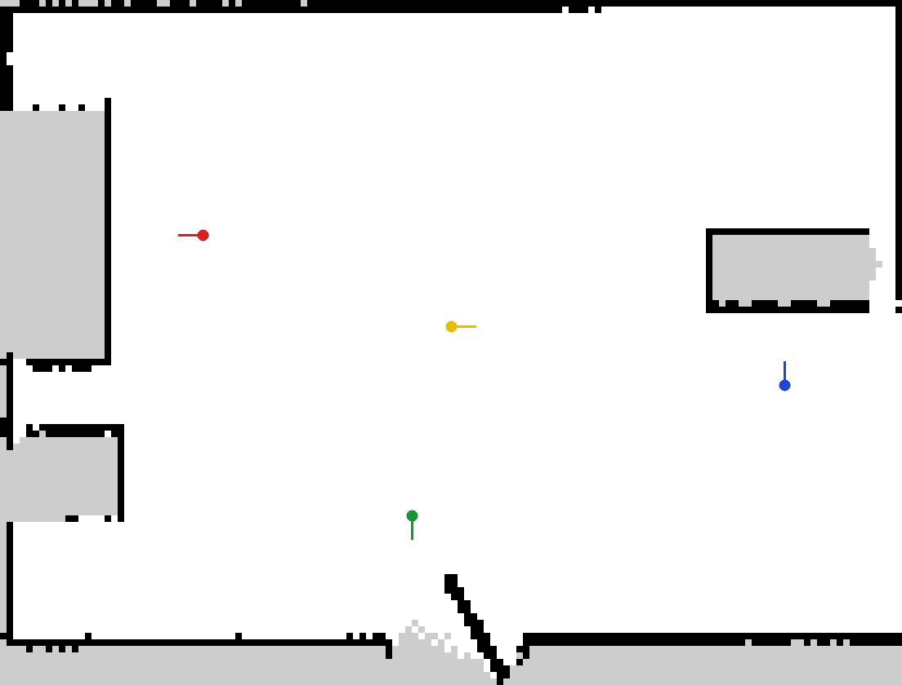

<div align="center">
  <h1>🤖 OmniBot: The OhhO Reference Architecture</h1>
  <p><strong>The official open-source mobile manipulation platform by OhhO Robotics</strong></p>

  <p align="center">
    
    
  </p>

  <p align="center">
    
    
  </p>

  <p align="center">
    <a href="https://www.youtube.com/@varun.vaidhiya/videos">
      
    </a>
    &nbsp;
    <a href="https://x.com/varunvaidhiya">
      
    </a>
    &nbsp;
    <a href="https://github.com/ohho-robotics/OmniBot/actions/workflows/ci.yml"></a>
    &nbsp;
    
    &nbsp;
    <a href="LICENSE"></a>
  </p>
</div>

OmniBot is OhhO Robotics' mecanum-wheel mobile manipulator. This repository holds the ROS 2 packages linked from [`src/`](src/), the [wheel kinematics](mecanum-kinematics/), the [Yahboom board protocol](yahboom-python-driver/), the [Quest project](omnibot-vr/), and the [Android app](omnibot-android/). The photos and GIFs above are the files in [`assets/`](assets/).

## CPU-only demo

No robot and no GPU. [`ohho-os` 1.1.2](https://pypi.org/project/ohho-os/1.1.2/) is on PyPI under [Apache-2.0](https://github.com/ohho-robotics/ohho-sdk/blob/main/LICENSE). `ohho doctor` and `ohho sim` are implemented in [`ohho/cli.py`](https://github.com/ohho-robotics/ohho-sdk/blob/main/ohho/cli.py); the sim adapter is [`ohho/adapters/sim.py`](https://github.com/ohho-robotics/ohho-sdk/blob/main/ohho/adapters/sim.py). The docs-test job in [`.github/workflows/ci.yml`](.github/workflows/ci.yml) runs these three commands in a fresh virtualenv via [`scripts/docs_test_readme.py`](scripts/docs_test_readme.py).

<!-- docs-test: cpu -->
```bash
pip install ohho-os
ohho doctor
ohho sim --robot omnibot --seconds 2
```

## ROS 2 path

Ubuntu 24.04 with ROS 2 Jazzy already installed. The symlinks in [`src/`](src/) are the colcon workspace. The `ros` job in [`.github/workflows/ci.yml`](.github/workflows/ci.yml) runs this block on `ros:jazzy-ros-base-noble`. The docs-test job skips it.

<!-- docs-test: skip ros -->
```bash
sudo apt-get update
sudo apt-get install -y python3-colcon-common-extensions python3-rosdep python3-pytest
sudo rosdep init || true
rosdep update
source /opt/ros/jazzy/setup.bash
rosdep install --from-paths src --ignore-src -y --rosdistro jazzy \
  --dependency-types=build \
  --dependency-types=buildtool \
  --dependency-types=build_export \
  --dependency-types=buildtool_export \
  --dependency-types=exec \
  --dependency-types=test
colcon build --symlink-install --base-paths src
source install/setup.bash
colcon test --base-paths src --event-handlers console_direct+ --return-code-on-test-failure
colcon test-result --verbose
```

## Needs hardware / needs GPU

| Feature | Needs | Evidence |
|---|---|---|
| `ohho sim --robot omnibot` | Neither | [ohho-os 1.1.2](https://pypi.org/project/ohho-os/1.1.2/) and the docs-test job in [ci.yml](.github/workflows/ci.yml) |
| Colcon build and test of `src/` | Neither | [src/](src/) and the `ros` job in [ci.yml](.github/workflows/ci.yml). That job needs ROS 2 Jazzy. |
| Kinematics, Yahboom codec, BEV homography, arm tick math, arm command safety (joint limits, 0.15 rad/cycle, 200 ms hold, e-stop torque latch), policy inference guards (black/missing frame refusal, latency drop, 0.15 rad/cycle arm clamp), learning engine, agent engine | Neither | The `cpu` job in [ci.yml](.github/workflows/ci.yml) runs `pytest omnibot-ros2/omnibot_arm/test omnibot-ai-ros2/omnibot_lerobot/test`. Those tests do not start ROS or the arm. |
| Xbox teleop, cameras, arm, LeRobot recording | Robot | [robot_with_joy.launch.py](omnibot-ros2/omnibot_bringup/launch/robot_with_joy.launch.py), [perception.launch.py](omnibot-ros2/omnibot_bringup/launch/perception.launch.py), [arm.launch.py](omnibot-ros2/omnibot_arm/launch/arm.launch.py), [teleop_record.launch.py](omnibot-ai-ros2/omnibot_lerobot/launch/teleop_record.launch.py) |
| Nav2 and SLAM on the real robot | Robot | [omnibot_navigation](omnibot-ros2/omnibot_navigation/). Not run on hardware for this change. |
| Nav2 + `slam_toolbox` in the Gazebo apartment world | Neither | [Nav2 + slam_toolbox in Gazebo](#nav2--slam_toolbox-in-gazebo-ohh-30), the [`nav-sim`](.github/workflows/nav-sim.yml) workflow, and the committed [run log](omnibot-ros2/omnibot_navigation/docs/nav_sim_runs_local_log.txt). Needs ROS 2 Jazzy and Gazebo Harmonic. |
| Gazebo compose files | Neither | [docker-compose.yml](omnibot-digital-twin/docker/docker-compose.yml) runs headless Gazebo. [docker-compose.gpu.yml](omnibot-digital-twin/docker/docker-compose.gpu.yml) is an optional NVIDIA overlay. The docs-test job does not start compose. |
| Gazebo Harmonic `sim.launch.py` | Neither | [sim.launch.py](omnibot-ros2/omnibot_bringup/launch/sim.launch.py) and the `sim-smoke` job in [ci.yml](.github/workflows/ci.yml). That job needs ROS 2 Jazzy and Gazebo Harmonic. The launch does not exit, so docs-test skips it. |
| OpenVLA / SmolVLA weights | GPU | [vla_engine/README.md](omnibot-ai-engines/vla_engine/README.md) and [requirements.txt](omnibot-ai-engines/vla_engine/requirements.txt) (`torch`) |
| Isaac Lab RL | GPU | [rl_engine/README.md](omnibot-ai-engines/rl_engine/README.md) and [requirements.txt](omnibot-ai-engines/rl_engine/requirements.txt) (`isaaclab`, `onnxruntime-gpu`) |
| Android controller | Robot | [omnibot-android/](omnibot-android/). Building it needs the Android SDK and JDK 17 ([`build.gradle.kts`](omnibot-android/build.gradle.kts)), which is separate from a desktop GPU. |
| Quest teleop | Robot | [omnibot-vr/](omnibot-vr/). Unity **6000.5.2f1** is pinned in [`ProjectSettings/ProjectVersion.txt`](omnibot-vr/ProjectSettings/ProjectVersion.txt). |

## Arm command safety

`arm_driver_node` drops follower torque when `/emergency_stop` is true (`Torque_Enable` 0) and leaves it off when the stop clears, until a later `/arm/enable` true arrives while the stop is false. An enable message received during the stop does not re-enable torque. If `/arm/joint_commands/out` is silent for `command_timeout_sec` (0.2 s) the driver holds the last accepted joint command and logs that once. Each accepted target is clamped to `joint_min` / `joint_max` and to `max_joint_delta_rad` per cycle. The shared default is `MAX_JOINT_DELTA_RAD` (0.15 rad) in [`omnibot-ros2/omnibot_arm/scripts/arm_safety.py`](omnibot-ros2/omnibot_arm/scripts/arm_safety.py). OHH-100 reuses that constant in `policy_node`. The Yahboom base controller already zeros velocity on `/emergency_stop`; this change does not modify that node.

In `policy_node`, inference guards enforce that missing or black camera frames (wrist or BEV) refuse publication with a throttled warning, actions from `select_action` taking longer than the policy period (1 / `policy_hz`) are dropped as stale, and arm command deltas are clamped to the same `MAX_JOINT_DELTA_RAD` (0.15 rad/cycle) limit as the driver.

The decisions above are unit-tested without ROS and without the arm (`pytest omnibot-ros2/omnibot_arm/test omnibot-ai-ros2/omnibot_lerobot/test`). Feetech bus writes, `ros2 launch`, and real model inference on hardware were not run for this behavior. Position servos only; there is no force control.

The launch files below target the physical robot. Docs-test skips them.

<!-- docs-test: skip hardware -->
```bash
ros2 launch omnibot_bringup robot_with_joy.launch.py
ros2 launch omnibot_bringup perception.launch.py
ros2 launch omnibot_arm arm.launch.py
ros2 launch omnibot_lerobot teleop_record.launch.py
```

## Gazebo Harmonic simulation

One command starts Gazebo Harmonic, spawns `omnibot_description`, and bridges the base. The default is headless (`gui:=false`), which is what the `sim-smoke` job runs. The launch does not exit, so docs-test skips it.

<!-- docs-test: skip ros -->
```bash
source /opt/ros/jazzy/setup.bash
source install/setup.bash
ros2 launch omnibot_bringup sim.launch.py world:=flat
```

`world:=apartment` loads a single room with a kitchen (counter, stove, fridge), a desk, and a door. Launch file: [`omnibot-ros2/omnibot_bringup/launch/sim.launch.py`](omnibot-ros2/omnibot_bringup/launch/sim.launch.py). The mecanum chassis is driven in the plane (`drive:=planar` by default; `drive:=mecanum` selects the MecanumDrive plugin). Sensors in this launch are a 2D lidar, the front RGB camera, and the IMU.

`ros_gz_bridge` topics. `rosbridge:=true` (the default) also starts `rosbridge_websocket` on port 9090. The sim-smoke test passes `rosbridge:=false` and does not start rosbridge:

| Topic | Type |
|---|---|
| `/cmd_vel` | `geometry_msgs/msg/Twist` |
| `/odom` | `nav_msgs/msg/Odometry` |
| `/scan` | `sensor_msgs/msg/LaserScan` |
| `/imu` | `sensor_msgs/msg/Imu` |
| `/camera/front/image_raw` | `sensor_msgs/msg/Image` |
| `/camera/front/camera_info` | `sensor_msgs/msg/CameraInfo` |
| `/tf` (`odom` -> `base_footprint`, added for Nav2 and `slam_toolbox`) | `tf2_msgs/msg/TFMessage` |

Bridge config: [`omnibot-ros2/omnibot_bringup/config/sim_bridge.yaml`](omnibot-ros2/omnibot_bringup/config/sim_bridge.yaml).

The headless launch test [`omnibot-ros2/omnibot_bringup/test/test_sim_launch.py`](omnibot-ros2/omnibot_bringup/test/test_sim_launch.py) checks that `/odom`, `/scan`, `/imu`, and `/camera/front/image_raw` publish within 30 s and that `/cmd_vel` moves the robot at least 0.2 m. The `sim-smoke` job in [`.github/workflows/ci.yml`](.github/workflows/ci.yml) runs it on `ros:jazzy`.

Eight frames from `/camera/front/image_raw` saved by that test (`OMNIBOT_SIM_FRAME_DIR`) while it published `/cmd_vel` in `world:=flat`. The red box is the `marker` model in [`flat.sdf`](omnibot-ros2/omnibot_bringup/worlds/flat.sdf):

<p align="center">
  
</p>

## Nav2 + slam_toolbox in Gazebo (OHH-30)

Simulation only. The apartment world from `sim.launch.py` is mapped with `slam_toolbox`, the saved map is checked in, and Nav2 (DWB) drives the holonomic base to the named waypoints `kitchen`, `desk`, and `door`. Nothing here was run on the real robot.

| Piece | Where |
|---|---|
| Mapping launch (`slam_toolbox`, headless Gazebo, scripted sweep) | [`sim_mapping.launch.py`](omnibot-ros2/omnibot_navigation/launch/sim_mapping.launch.py), [`sim_map_sweep.py`](omnibot-ros2/omnibot_navigation/scripts/sim_map_sweep.py) |
| Saved map and how to regenerate it | [`maps/`](omnibot-ros2/omnibot_navigation/maps/) (`apartment.yaml`, `apartment.pgm`, `apartment.posegraph`, `apartment.data`), [`maps/README.md`](omnibot-ros2/omnibot_navigation/maps/README.md), [`generate_sim_map.sh`](omnibot-ros2/omnibot_navigation/scripts/generate_sim_map.sh) |
| Named waypoints, map frame | [`config/waypoints.yaml`](omnibot-ros2/omnibot_navigation/config/waypoints.yaml), read by [`go_to_waypoint.py`](omnibot-ros2/omnibot_navigation/scripts/go_to_waypoint.py), [`waypoint_navigator.py`](omnibot-ros2/omnibot_navigation/scripts/waypoint_navigator.py), and the scenario test |
| Nav2 on the saved map | [`sim_navigation.launch.py`](omnibot-ros2/omnibot_navigation/launch/sim_navigation.launch.py), [`config/nav2_params.yaml`](omnibot-ros2/omnibot_navigation/config/nav2_params.yaml) |
| Integration test (kitchen within 60 s from the start pose; desk and door the same way) | [`test_nav_sim_scenarios.py`](omnibot-ros2/omnibot_navigation/test/test_nav_sim_scenarios.py), [`run_nav_scenarios.sh`](omnibot-ros2/omnibot_navigation/scripts/run_nav_scenarios.sh) |
| CI: 3 scenarios, nightly and `workflow_dispatch` | [`.github/workflows/nav-sim.yml`](.github/workflows/nav-sim.yml) |

The launch files and the scenario runner need ROS 2 Jazzy and Gazebo Harmonic, so docs-test skips them.

<!-- docs-test: skip ros -->
```bash
source /opt/ros/jazzy/setup.bash
source install/setup.bash
# Map the apartment with slam_toolbox (drives a fixed sweep, saves into maps/)
omnibot-ros2/omnibot_navigation/scripts/generate_sim_map.sh
# Nav2 on the saved map, then send the robot to a named waypoint
ros2 launch omnibot_navigation sim_navigation.launch.py
ros2 run omnibot_navigation go_to_waypoint.py kitchen
# The CI scenarios: a fresh sim per run, non-zero exit if any run fails
omnibot-ros2/omnibot_navigation/scripts/run_nav_scenarios.sh kitchen desk door
```

<p align="center">
  
</p>

The saved map with the start pose (yellow), `kitchen` (red), `desk` (blue), and `door` (green), drawn by [`render_map_overlay.py`](omnibot-ros2/omnibot_navigation/scripts/render_map_overlay.py). Grey is unknown space (inside the furniture and outside the walls).

### Time to goal

Each run starts a fresh headless Gazebo sim with the robot at the spawn pose (0, 0, yaw 0). Time is Gazebo simulation time from goal acceptance to Nav2 `SUCCEEDED`, with a 60 s limit. A run passes only if Nav2 succeeds in time **and** the final ground-truth pose (`/odom`, exact in the planar sim) is within 0.30 m and 0.50 rad of the waypoint. Nav2's own goal checker is tighter: 0.15 m and 0.20 rad.

| Scenario | Goal (map frame) | Runs | Passed | Time to goal, min / median / max (s) |
|---|---|---|---|---|
| `kitchen` | x -1.90, y 0.70, yaw 180 deg | 5 | 5 | 15.7 / 17.0 / 17.5 |
| `desk` | x 2.55, y -0.45, yaw 90 deg | 5 | 5 | 18.8 / 20.0 / 21.6 |
| `door` | x -0.30, y -1.45, yaw -90 deg | 5 | 5 | 8.2 / 12.8 / 13.4 |

Where these numbers come from: the 15 runs in [`nav_sim_runs_local.jsonl`](omnibot-ros2/omnibot_navigation/docs/nav_sim_runs_local.jsonl) and [`nav_sim_runs_local_log.txt`](omnibot-ros2/omnibot_navigation/docs/nav_sim_runs_local_log.txt), made with `run_nav_scenarios.sh --repeat 5 kitchen desk door` in a `ros:jazzy-ros-base-noble` Docker container (Mesa software rendering, 16 CPUs, real-time factor 1.0 in every run). They are local runs, not a GitHub Actions run. The [`nav-sim`](.github/workflows/nav-sim.yml) workflow produces the same table for each CI run in its job summary and artifacts; its nightly schedule runs each scenario 5 times in a row. Times on a CI runner may differ.

### Nav2 tuning for the mecanum base

Changes to [`nav2_params.yaml`](omnibot-ros2/omnibot_navigation/config/nav2_params.yaml), each of which the file now comments:

- DWB stays. The base is holonomic and DWB samples `vx`, `vy`, and `vtheta` (`vy_samples: 10`, `min_vel_y` -0.20, `max_vel_y` 0.20). `min_y_velocity_threshold` was 0.5, above `max_vel_y`, so the controller zeroed every lateral command. It is now 0.001. [`test_nav_assets.py`](omnibot-ros2/omnibot_navigation/test/test_nav_assets.py) fails if it goes back above `max_vel_y`.
- MPPI was not needed: 15 of 15 runs reached their goal in under 23 s with DWB once the lateral threshold above was fixed, so MPPI was not tried.
- Footprint is the 0.30 x 0.28 m rectangle around the 0.265 x 0.250 m chassis instead of a 0.22 m circle.
- Velocity caps stay at 0.20 m/s and 1.0 rad/s, the Yahboom driver clamp, so sim and robot limits match.
- Fixes needed to start on Jazzy at all: `nav2_amcl::OmniMotionModel` (the old class name does not exist), `nav2_navfn_planner::NavfnPlanner` (old `/` name not found), no `plugin_lib_names` list (it re-registers built-in BT nodes and crashes `bt_navigator`), a `behavior_server` section, and `slam_toolbox` launched as a lifecycle node (it stayed `unconfigured` before) with `map_file_name: ""` (the old `omnibot_map` made it fail to load a pose graph at start).

Not covered: `drive:=mecanum` (wheel-physics) with Nav2 was tried once and the `map` frame never appeared before Nav2's startup timeout, so `sim_navigation.launch.py` uses the planar holonomic drive only. The 3-D RTAB-Map stack, real-robot SLAM/Nav2, and bags are untouched.

## Teleop from the website

[OHH-89](https://linear.app/ohho-robotics/issue/OHH-89) is the website issue for Connect. Start the flat Gazebo world, then open Connect and set the ROSBridge URL to `ws://localhost:9090`. rosbridge listens on localhost only by default; `rosbridge_address:=0.0.0.0` exposes it on the network without authentication. The launch does not exit, so the docs-test job skips this fence.

<!-- docs-test: skip ros -->
```bash
# omnibot-docs-test: skip ros
ros2 launch omnibot_bringup sim.launch.py world:=flat
```

`/cmd_vel` moves the base, `/odom` publishes, and `/camera/front/image_raw` publishes when the camera sensor starts. `world:=apartment` stays the furnished world.

The requirement files below pull GPU stacks. Docs-test skips them.

<!-- docs-test: skip gpu -->
```bash
pip install -r omnibot-ai-engines/vla_engine/requirements.txt
pip install -r omnibot-ai-engines/rl_engine/requirements.txt
```

## Bring-up control mode

`mobile_manipulation.launch.py` starts `cmd_vel_mux` and `arm_cmd_mux` in `teleop`. `/cmd_vel/teleop` is forwarded. Nav2, VLA, and RL base commands, and both arm command sources, are not forwarded until `/control_mode` is `vla`, `nav2`, or `rl_nav`. Setting `/control_mode` back to `teleop` stops the autonomous base and arm streams on that callback and still forwards `/cmd_vel/teleop`. Publishing `/emergency_stop` true stops base and arm outputs, including teleop, on that callback. `/arm/joint_commands` is shared by the policy and the Android app, so Android joint commands wait for an autonomous mode as well.

`hybrid_robot.launch.py` and `omnibot_pi.launch.py` still pass `default_mode:=nav2` for the base mux. This gate was unit-tested here without ROS 2. It was not run with `ros2 launch`, Gazebo, or a robot.

## Layout

| Directory | What it is |
|---|---|
| [`src/`](src/) | Colcon workspace (symlinks) |
| [`omnibot-ros2/`](omnibot-ros2/) | Driver, arm, description, bringup, Nav2 |
| [`omnibot-ai-ros2/`](omnibot-ai-ros2/) | VLA, LeRobot, RL, and orchestration nodes |
| [`omnibot-ai-engines/`](omnibot-ai-engines/) | Learning and agent engines, plus the GPU training trees |
| [`mecanum-kinematics/`](mecanum-kinematics/) | Wheel inverse and forward kinematics |
| [`yahboom-python-driver/`](yahboom-python-driver/) | Yahboom serial protocol |
| [`ros2-bev-stitcher/`](ros2-bev-stitcher/) | Bird's-eye homography |
| [`omnibot-digital-twin/`](omnibot-digital-twin/) | Gazebo world and compose files |
| [`omnibot-android/`](omnibot-android/) | Kotlin controller |
| [`omnibot-vr/`](omnibot-vr/) | Unity Quest project |

## License

[Apache-2.0](LICENSE) for OhhO code in this repository. Vendored Meta XR SDK and CoplayDev unity-mcp packages keep their own licences. See [NOTICE](NOTICE).
