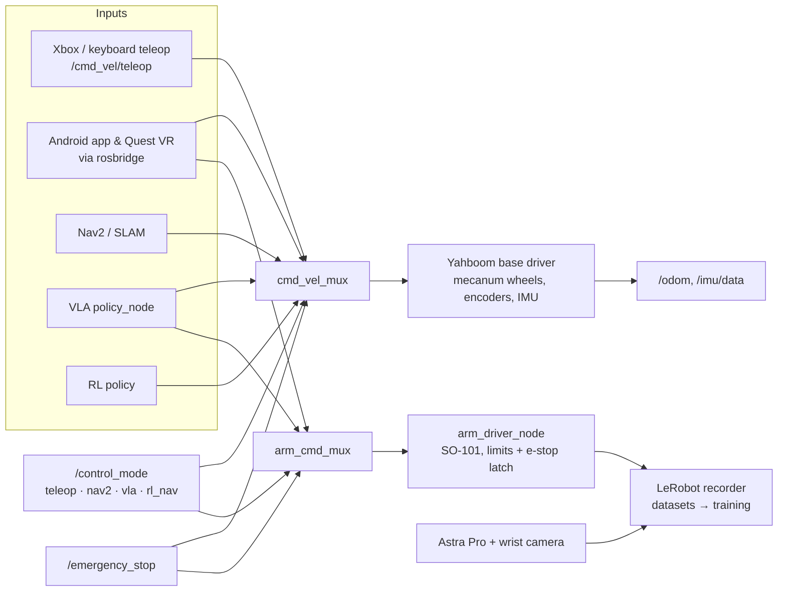

<div align="center">
  <h1>🤖 OmniBot: The OhhO Reference Architecture</h1>
  <p><strong>The official open-source mobile manipulation platform by OhhO Robotics</strong></p>

  <p align="center">
    
    
  </p>

  <p align="center">
    
    
  </p>

  <p align="center">
    <a href="https://www.youtube.com/@varun.vaidhiya/videos">
      
    </a>
    &nbsp;
    <a href="https://x.com/varunvaidhiya">
      
    </a>
    &nbsp;
    <a href="https://github.com/ohho-robotics/OmniBot/actions/workflows/ci.yml"></a>
    &nbsp;
    
    &nbsp;
    <a href="LICENSE"></a>
  </p>
</div>

<p align="center"><strong>An open-source ROS 2 Jazzy mobile manipulator (mecanum base + SO-101 arm) that you can run in simulation on a laptop in three commands, then build at home.</strong></p>

<p align="center">⭐ <strong>If OmniBot is useful or interesting to you, please star the repo</strong>: it helps other robotics people find it.</p>

## Why OmniBot

- **Full mobile-manipulation stack in one repo**: mecanum base driver and kinematics, SO-101 arm with e-stop and joint-limit safety, Nav2/SLAM, Gazebo Harmonic sim, and LeRobot data capture feeding VLA/RL policies.
- **Teleop from anywhere**: Xbox gamepad, Android app, Meta Quest VR, or the browser via rosbridge.
- **Honest and tested**: README commands run in CI. Anything that needs a robot or GPU is labelled as such in [docs/reference.md](docs/reference.md).

## Quickstart (no robot, no GPU)

[`ohho-os`](https://pypi.org/project/ohho-os/) is on PyPI under [Apache-2.0](https://github.com/ohho-robotics/ohho-sdk/blob/main/LICENSE). The docs-test job in [`.github/workflows/ci.yml`](.github/workflows/ci.yml) runs these three commands in a fresh virtualenv via [`scripts/docs_test_readme.py`](scripts/docs_test_readme.py).

<!-- docs-test: cpu -->
```bash
pip install ohho-os
ohho doctor
ohho sim --robot omnibot --seconds 2
```

## Build the ROS 2 workspace

Ubuntu 24.04 with ROS 2 Jazzy already installed. The symlinks in [`src/`](src/) are the colcon workspace. The `ros` CI job runs this block on `ros:jazzy-ros-base-noble`.

<!-- docs-test: skip ros -->
```bash
sudo apt-get update
sudo apt-get install -y python3-colcon-common-extensions python3-rosdep python3-pytest
sudo rosdep init || true
rosdep update
source /opt/ros/jazzy/setup.bash
rosdep install --from-paths src --ignore-src -y --rosdistro jazzy \
  --dependency-types=build \
  --dependency-types=buildtool \
  --dependency-types=build_export \
  --dependency-types=buildtool_export \
  --dependency-types=exec \
  --dependency-types=test
colcon build --symlink-install --base-paths src
source install/setup.bash
colcon test --base-paths src --event-handlers console_direct+ --return-code-on-test-failure
colcon test-result --verbose
```

Then start the Gazebo sim with `ros2 launch omnibot_bringup sim.launch.py world:=flat`. See [docs/reference.md](docs/reference.md) for worlds, bridged topics and browser teleop.

On the physical robot (docs-test skips this):

<!-- docs-test: skip hardware -->
```bash
ros2 launch omnibot_bringup robot_with_joy.launch.py
ros2 launch omnibot_bringup perception.launch.py
ros2 launch omnibot_arm arm.launch.py
ros2 launch omnibot_lerobot teleop_record.launch.py
```

GPU policy stacks (OpenVLA / SmolVLA, Isaac Lab RL) need a desktop NVIDIA GPU, not the Raspberry Pi:

<!-- docs-test: skip gpu -->
```bash
pip install -r omnibot-ai-engines/vla_engine/requirements.txt
pip install -r omnibot-ai-engines/rl_engine/requirements.txt
```

## Hardware (bill of materials)

These are the parts referenced in this repo's code and docs. Prices are not yet documented. Help fill them in via [#19](https://github.com/ohho-robotics/OmniBot/issues/19).

| Part | Qty | Where it is referenced | Approx. price |
|---|---|---|---|
| Mecanum chassis with 4 wheels (80 mm diameter, 0.215 m × 0.165 m wheel spacing) | 1 | [`mecanum-kinematics/config/mecanum_params.yaml`](mecanum-kinematics/config/mecanum_params.yaml) | TBD |
| Yahboom motor driver board (motors, wheel encoders, onboard IMU; USB serial 115200) | 1 | [`yahboom-python-driver/`](yahboom-python-driver/), [sensor guide](omnibot-ros2/omnibot_navigation/docs/SENSOR_INTEGRATION.md) | TBD |
| Raspberry Pi 5 (onboard compute) | 1 | [`omnibot_pi.launch.py`](omnibot-ros2/omnibot_bringup/launch/master/omnibot_pi.launch.py) | TBD |
| SO-101 arm (Feetech STS3215 servos) | 1 | [`omnibot-ros2/omnibot_arm/config/arm_params.yaml`](omnibot-ros2/omnibot_arm/config/arm_params.yaml), [meshes](omnibot-ros2/omnibot_description/meshes/so101/) | TBD |
| Orbbec Astra Pro RGB-D camera | 1 | [sensor guide](omnibot-ros2/omnibot_navigation/docs/SENSOR_INTEGRATION.md) | TBD |
| Wrist camera | 1 | [`perception.launch.py`](omnibot-ros2/omnibot_bringup/launch/perception.launch.py) | TBD |
| Xbox controller (teleop) | 1 | [`robot_with_joy.launch.py`](omnibot-ros2/omnibot_bringup/launch/robot_with_joy.launch.py) | TBD |
| Meta Quest 3 / 3S (optional VR teleop) | 0–1 | [`omnibot-vr/`](omnibot-vr/) | TBD |
| Desktop PC with NVIDIA GPU (optional, VLA/RL) | 0–1 | [`omnibot-ai-ros2/omnibot_vla/README.md`](omnibot-ai-ros2/omnibot_vla/README.md) | TBD |
| Battery, wiring, mounts | — | Not documented yet | TBD |

## Architecture



Details: control-mode gating in [docs/reference.md](docs/reference.md#bring-up-control-mode), arm and policy safety in [docs/safety.md](docs/safety.md).

## Roadmap

- [ ] Nav2 + slam_toolbox in Gazebo with named waypoints (in review: [#18](https://github.com/ohho-robotics/OmniBot/pull/18))
- [ ] Hardware build guide and priced BOM ([#19](https://github.com/ohho-robotics/OmniBot/issues/19))
- [ ] MuJoCo backend for `mujoco.launch.py` ([#24](https://github.com/ohho-robotics/OmniBot/issues/24)); Isaac backend after that
- [ ] SO-100 arm support ([#26](https://github.com/ohho-robotics/OmniBot/issues/26))
- [ ] WebRTC video for the Quest client (MJPEG today)
- [ ] First tagged release, v0.1.0

## Contributing & community

New here? Pick a [**good first issue**](https://github.com/ohho-robotics/OmniBot/issues?q=is%3Aissue+is%3Aopen+label%3A%22good+first+issue%22) or a [**help wanted**](https://github.com/ohho-robotics/OmniBot/issues?q=is%3Aissue+is%3Aopen+label%3A%22help+wanted%22) issue. Questions, build photos and ideas go in [**Discussions**](https://github.com/ohho-robotics/OmniBot/discussions). Contribution guidelines and the code of conduct live in the [org `.github` repo](https://github.com/ohho-robotics/.github).

Demos and updates: [YouTube](https://www.youtube.com/@varun.vaidhiya/videos) · [X @varunvaidhiya](https://x.com/varunvaidhiya).

## Layout

| Directory | What it is |
|---|---|
| [`src/`](src/) | Colcon workspace (symlinks) |
| [`omnibot-ros2/`](omnibot-ros2/) | Driver, arm, description, bringup, Nav2 |
| [`omnibot-ai-ros2/`](omnibot-ai-ros2/) | VLA, LeRobot, RL, and orchestration nodes |
| [`omnibot-ai-engines/`](omnibot-ai-engines/) | Learning and agent engines, plus the GPU training trees |
| [`mecanum-kinematics/`](mecanum-kinematics/) | Wheel inverse and forward kinematics |
| [`yahboom-python-driver/`](yahboom-python-driver/) | Yahboom serial protocol |
| [`ros2-bev-stitcher/`](ros2-bev-stitcher/) | Bird's-eye homography |
| [`omnibot-digital-twin/`](omnibot-digital-twin/) | Gazebo world and compose files |
| [`omnibot-android/`](omnibot-android/) | Kotlin controller |
| [`omnibot-vr/`](omnibot-vr/) | Unity Quest project |

## License

[Apache-2.0](LICENSE) for OhhO code in this repository. Vendored Meta XR SDK and CoplayDev unity-mcp packages keep their own licences. See [NOTICE](NOTICE).

⭐ **Star the repo** to follow progress.
